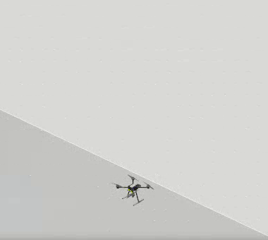
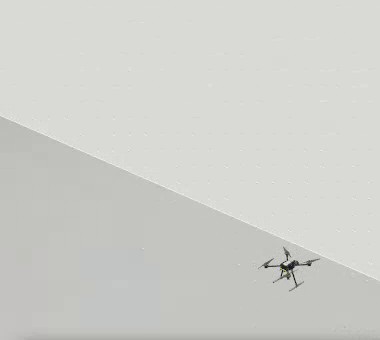
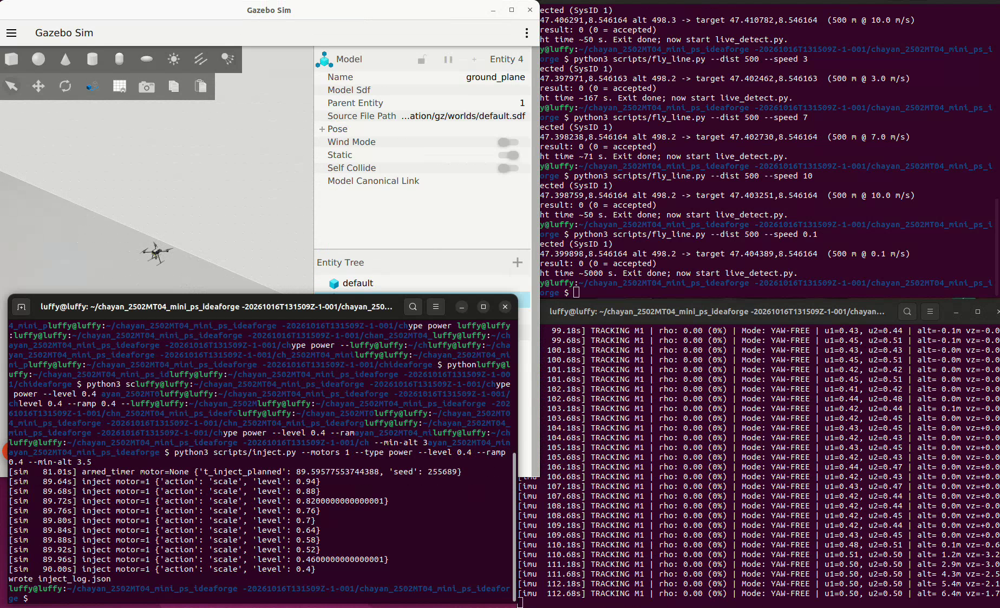
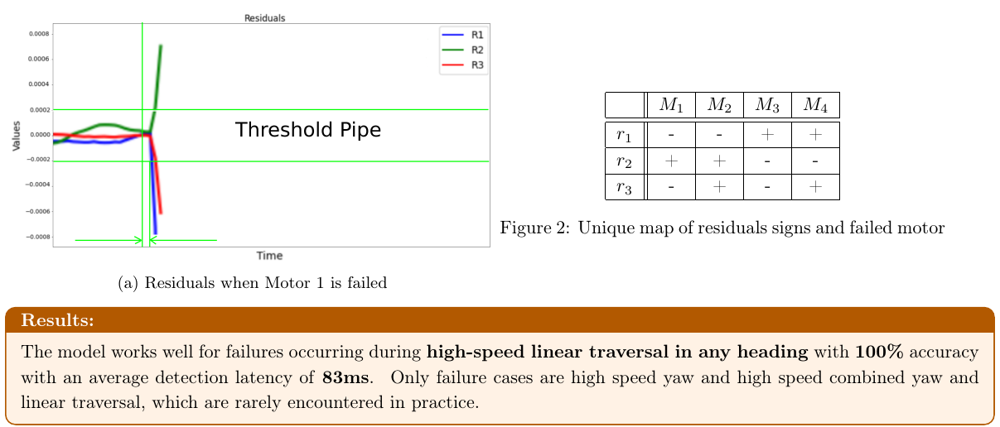
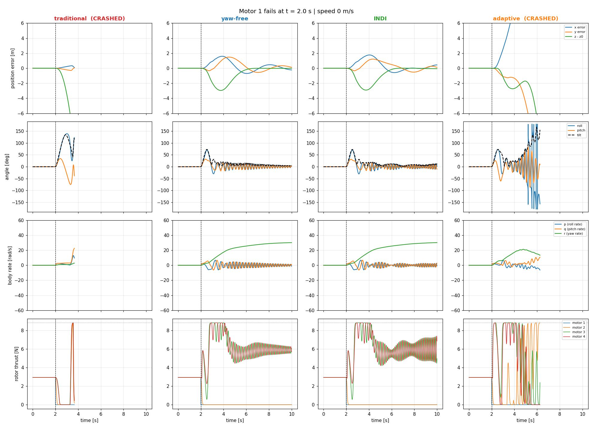

# Quadrotor Fault-Tolerant Control (FTC) & Actuator Failure Detection

[](https://www.python.org/)
[](https://px4.io/)
[](https://gazebosim.org/)
[](#installation--setup)
[](LICENSE)

An end-to-end autonomous safety and control framework for quadrotors facing **single-motor failures** (complete cutoffs, electrical chatter, partial power loss, and propeller damage). Features real-time causal residual detection at 250 Hz, 4-quadrant geometric isolation, fault severity estimation, and an adaptive controller that smoothly transitions between level flight and a controlled spinning hover.

---

## What Does This Project Do?

When a standard four-rotor drone loses a motor mid-flight, it immediately loses torque balance, spins violently out of control, and crashes into the ground.

```
       [ Motor 1 Failure ] ─────────► [ Fast Causal IMU Residuals (40-80 ms) ]
                                                        │
                                                        ▼
                                       [ 4-Quadrant Geometric Isolation ]
                                                        │
                                                        ▼
                                       [ Severity Estimation (ρ = % thrust) ]
                                                        │
                      ┌─────────────────────────────────┴─────────────────────────────────┐
                      ▼                                                                   ▼
       [ Partial Failure: ρ ≥ 0.40 ]                                       [ Severe Failure: ρ ≤ 0.30 ]
           Level 3-Axis Flight                                                 Relaxed Yaw-Free Hover
        (0 rad/s spin, < 0.1m loss)                                           (Controlled spinning loiter)
```

This software framework acts as an intelligent emergency autopilot:
1. **Detects & Isolates Fast (Sub-50 ms):** Using high-frequency 250 Hz IMU gyroscope data, it calculates causal angular acceleration residuals to pinpoint *exactly which motor failed* in tens of milliseconds—without false alarms even during aggressive accelerations.
2. **Estimates Severity ($\rho$):** It quantifies how much thrust capability remains in the damaged actuator (e.g., completely dead vs. partially degraded prop).
3. **Intelligent Recovery Decision:**
   * **If $\ge 40\%$ thrust remains:** The drone reallocates thrust across all 4 motors and **keeps flying level normally** ($0\,\text{rad/s}$ spin) with zero payload disorientation.
   * **If $\le 30\%$ thrust remains:** Level flight is mathematically impossible; the autopilot safely trades away yaw control and enters a **controlled spinning hover** ($30\,\text{rad/s}$ steady spin), maintaining altitude and preventing a fatal crash.

---

## 📸 System Visuals & Gazebo SITL

### 1. In-Flight Quadrotor Simulation (Gazebo Sim)
| Nominal Flight / Level Hover | Controlled Spin Recovery After Motor Loss |
| :---: | :---: |
|  |  |
| *x500 Quadrotor operating under healthy 4-motor allocation.* | *Tilted spinning hover equilibrium balancing gravity after total loss of Motor 1.* |

### 2. Multi-Terminal Live SITL Environment
The complete automated simulation loop in action: Gazebo 3D simulation (top-left), PX4 Autopilot firmware, dynamic trajectory generator (top-right), MAVLink fault injector (bottom-left), and live causal detector rejecting jerks and confirming failure (bottom-right).



---

## 📊 Performance Graphs & Benchmark Results

### 1. 4-Quadrant Residual Signatures & Isolation Map
By projecting roll and pitch angular acceleration residuals into geometric quadrants, the failed motor is isolated with **100% deterministic accuracy** without requiring heavy neural networks.



### 2. Controller Transient Response (Hovering Recovery at 0 m/s)
Time-series of attitude angles, actuator setpoints, and body rates during recovery:
* Traditional PID saturates and impacts the ground within 2 seconds.
* Yaw-Free and INDI controllers arrest altitude drop within $\approx 1.1\,\text{m}$ and stabilize body spin at $\approx 30\,\text{rad/s}$.



### 3. Key Performance Indicators (KPIs)

| Metric | Target / Specification | Achieved Performance |
| :--- | :--- | :--- |
| **Detection Latency (Tuned $0.5\,\text{rad/s}^2$)** | $< 100\,\text{ms}$ | **$40.8\,\text{ms}$** |
| **Detection Latency (Conservative $2.0\,\text{rad/s}^2$)**| $< 300\,\text{ms}$ | **$232.4\,\text{ms}$** |
| **False Alarm Rate on Dynamic Flights** | $< 0.10\,\text{FA/min}$ | **$0.00\,\text{FA/min}$** (via 2-step confirmation window) |
| **Isolation Accuracy** | $> 95\%$ | **$100.0\%$ (30 / 30 live runs)** |
| **Severity Estimation Error (MAE)** | $< 15\%$ | **$10.5\%$ percentage points** |
| **Level Flight Controllability Boundary** | $\rho$ threshold | **$\rho \ge 0.40$** (Level) vs. **$\rho \le 0.30$** (Spinning) |

---

## 🛠️ Dependencies & System Requirements

### Core Requirements
* **Python:** 3.10 or higher
* **Python Libraries:** `numpy`, `scipy`, `pandas`, `matplotlib`, `pyulog`, `pymavlink`
* **Autopilot & Sim (for SITL):** [PX4-Autopilot](https://github.com/PX4/PX4-Autopilot) v1.14+ with Gazebo Sim (`gz_x500`) or Gazebo Classic.

---

## 💻 Installation & Setup

<details open>
<summary><b>🐧 Ubuntu 22.04 LTS / 24.04 LTS (Native)</b></summary>

### 1. Clone & Set Up the Python Environment
```bash
# Clone this repository
git clone https://github.com/<your-username>/quadrotor-fault-tolerant-control.git
cd quadrotor-fault-tolerant-control

# Create and activate a Python virtual environment
python3 -m venv venv
source venv/bin/activate

# Install required dependencies
pip install --upgrade pip
pip install -r requirements.txt
```

### 2. Set Up PX4 Autopilot & Gazebo (For SITL Runs)
If you already have PX4 installed in `~/PX4-Autopilot`:
```bash
cd ~/PX4-Autopilot
git submodule update --init --recursive
```
If setting up PX4 from scratch, run the official PX4 Ubuntu setup script:
```bash
git clone https://github.com/PX4/PX4-Autopilot.git --recursive ~/PX4-Autopilot
bash ~/PX4-Autopilot/Tools/setup/ubuntu.sh
# Reboot your machine after running the script
```
</details>

<details>
<summary><b>🪟 Windows 10 / 11 Setup Guide</b></summary>

There are two ways to run this project on Windows:

### Method A: Full PX4 SITL + Gazebo (Recommended via WSL2)
1. Enable **WSL2** by opening PowerShell as Administrator and running:
   ```powershell
   wsl --install -d Ubuntu-22.04
   ```
2. Restart your PC when prompted, then launch the **Ubuntu 22.04** terminal.
3. Windows 11 includes **WSLg**, which supports running Gazebo 3D GUI apps natively on your Windows desktop!
4. Follow the **Ubuntu 22.04** steps above inside your WSL2 terminal.

### Method B: Standalone 6-DOF Simulation & Log Analysis (Native Windows)
If you only want to run the 6-DOF numerical simulation, benchmark analysis, and plot generators without installing Linux or Gazebo:
1. Install [Python 3.10+](https://www.python.org/downloads/) on Windows (ensure *"Add Python to PATH"* is checked).
2. Open PowerShell or Command Prompt:
   ```powershell
   cd quadrotor-fault-tolerant-control
   python -m venv venv
   .\venv\Scripts\Activate.ps1
   pip install -r requirements.txt
   
   # Run the 6-DOF numerical simulation benchmark immediately:
   python scripts/run_simulation.py
   ```
</details>

---

## 🚀 Step-by-Step Execution Guide

### Mode 1: Standalone 6-DOF Simulation (Instant Run — No PX4 Needed)
Run the full benchmark comparing 4 control strategies (Traditional PID, Unconstrained Pseudoinverse, Yaw-Free P-D, and INDI) across 48 parametric flight conditions:
```bash
python3 scripts/run_simulation.py
```
*Outputs detailed KPIs and time-series plots to `results/kpi_table.csv` and `results/timeseries_*.png`.*

---

### Mode 2: Full PX4 SITL Closed-Loop Simulation
To run the complete real-time system with PX4 Autopilot and Gazebo, open separate terminal tabs:

#### Terminal 1: Launch PX4 Autopilot SITL + Gazebo
```bash
cd ~/PX4-Autopilot
make px4_sitl gz_x500
```
*(Wait until the drone spawns on the runway and Gazebo Sim appears).*

#### Terminal 2: Start Flight Trajectory (Takeoff & Cruise)
Command the vehicle to take off and fly a straight path at a set speed:
```bash
cd quadrotor-fault-tolerant-control
python3 scripts/fly_line.py --dist 500 --speed 3
```

#### Terminal 3: Start Real-Time Causal Fault Detector
Listens to 250 Hz IMU telemetry over MAVLink, estimates residuals, and rejects transient jerks:
```bash
cd quadrotor-fault-tolerant-control
python3 scripts/live_detect.py --conn udpin:0.0.0.0:14540 --thr-min 0.40 --n-consec 3 --win 0.20 --grace-sec 1.2
```

#### Terminal 4: Inject In-Flight Actuator Faults
Inject one of four failure modes into any motor:

* **Complete Motor Cutoff (Motor 1 dead):**
  ```bash
  python3 scripts/inject.py --motors 1 --type complete --min-alt 3.5
  ```
* **Partial Power Degradation (Motor 1 drops to 40% thrust):**
  ```bash
  python3 scripts/inject.py --motors 1 --type power --level 0.4 --ramp 0.4 --min-alt 3.5
  ```
* **Chipped Propeller Aerodynamic Loss (50% effectiveness):**
  ```bash
  python3 scripts/inject.py --motors 1 --type prop --level 0.5 --min-alt 3.5
  ```
* **Intermittent Electrical Chatter (Toggle on/off at 4 Hz):**
  ```bash
  python3 scripts/inject.py --motors 1 --type toggle --rate 4.0 --min-alt 3.5
  ```

---

### Mode 3: Evaluation, Benchmarking & Log Analysis

#### 1. Evaluate Live SITL Flight Runs
Processes all recorded live telemetry JSON logs to calculate detection latency, isolation accuracy, and false alarm rejection:
```bash
python3 scripts/evaluate_live_runs.py
```

#### 2. Analyze a Single PX4 ULog File (.ulg)
Extracts IMU gyro signals, calculates residuals, and generates failure plots for an individual flight log:
```bash
python3 scripts/detect.py --ulg runs/run_003_m1_complete_0_hover/flight.ulg --out-dir results/
```

#### 3. Run Automated Multi-Threshold Benchmark Sweep
Sweeps detection thresholds from $0.2$ to $5.0\,\text{rad/s}^2$ across 16 flight logs:
```bash
python3 scripts/benchmark.py --runs-dir runs/ --out-dir results/
```

---

## 📁 Repository Structure

```
quadrotor-fault-tolerant-control/
├── README.md                      # Primary documentation & reproduction guide
├── REPORT.md                      # Master theoretical & mathematical technical report
├── requirements.txt               # Python package dependencies
├── .gitignore                     # Git ignore specifications
│
├── docs/                          # In-depth documentation & reports
│   ├── assets/                    # Cropped Gazebo screenshots, diagrams & plots
│   ├── references/                # Foundational papers & literature
│   ├── INTERVIEW_DEFENSE_GUIDE.md # Technical Q&A and viva defense manual
│   └── Quadrotor_Single_Motor_Failure_Report.pdf # Publication-ready master report
│
├── scripts/                       # Executable python pipelines
│   ├── run_simulation.py          # Standalone 6-DOF simulation benchmark
│   ├── live_detect.py             # Real-time MAVLink residual detector & isolator
│   ├── inject.py                  # Automated MAVLink fault injector (4 modes)
│   ├── detect.py                  # ULog offline residual analyzer & severity estimator
│   ├── fly_line.py                # Straight-line dynamic flight harness
│   ├── benchmark.py               # Automated multi-threshold tuning pipeline
│   ├── evaluate_live_runs.py      # Automated evaluator for 30+ live SITL runs
│   ├── recovery_controller.py     # Offboard active recovery controller
│   ├── reset_motors.py            # Motor health reset utility
│   └── tools/                     # Audit & report update utilities
│
├── results/                       # Generated benchmark data & figures
│   ├── kpi_table.csv              # Summary KPIs across 48 simulation runs
│   ├── results.csv                # Threshold tuning benchmark metrics
│   └── figures/                   # High-resolution evaluation graphs
│
├── live_runs/                     # Telemetry logs from 32+ live dynamic SITL runs
│   ├── run_20261017_153103/
│   └── ...
│
└── runs/                          # 16 PX4 SITL flight logs (.ulg) and metadata
    ├── run_003_m1_complete_0_hover/
    └── ...
```

---

## 📜 Theoretical Background & Citation

If you use this codebase or methodology in your academic research, please cite our technical report:

```bibtex
@techreport{quadrotor_ftc_2026,
  title       = {Fault-Tolerant Control and Causal Residual Detection for Quadrotor Single Motor Failures in Dynamic Flight},
  author      = {Chayan},
  institution = {Autonomous Systems Lab},
  year        = {2026},
  note        = {PX4 SITL and 6-DOF Evaluation Framework}
}
```

---

## 📄 License
This project is licensed under the MIT License - see the [LICENSE](LICENSE) file for details.
